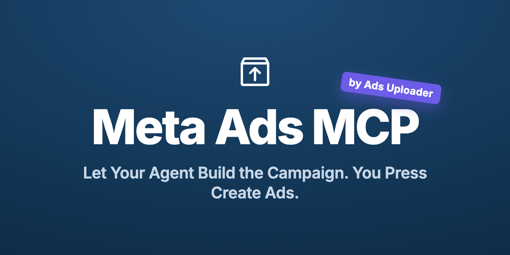

<p align="center">
  
</p>

<h1 align="center">Ads Uploader: Meta Ads MCP</h1>

<p align="center">The <strong>Meta Ads MCP</strong> server by Ads Uploader lets Claude, ChatGPT, Cursor and Codex analyze, edit and launch Meta (Facebook &amp; Instagram) ads, with an Agent Inbox for anything you want to approve first.</p>

<p align="center">
  <a href="https://adsuploader.com/mcp-meta-ads"></a>
  
  
  <a href="https://github.com/adsuploader/meta-ads-mcp/stargazers"></a>
</p>

---

Connect your AI agent to Ads Uploader and it can read performance, change live campaigns and launch new ads in bulk, using the same launch engine as the Ads Uploader web app. You decide, per ad account, what the agent can do on its own and what waits in the **Agent Inbox** for a person to approve.

Requires an existing paid Ads Uploader account with MCP access and a connected Meta account with the necessary permissions. MCP access is not included in trials.

This repository contains public documentation and connector configuration. Ads Uploader is a proprietary product; its application, backend and MCP server implementation are not included here. See [License](#license) for the scope of reuse permissions.

## What it does

- **Analyze.** Query Meta Ads Insights, check campaign health, read account status and spend, see Meta's change history, estimate audience size and delivery, and list audiences, conversions, library media and posts.
- **Edit live campaigns.** Preview a change, then apply it: budgets, bids, status, ad set targeting and settings, ad creative text and links, and deletes. Every edit is logged, and your agent can undo reversible edits.
- **Launch in bulk.** Copy the settings of an ad you already run, then build new ads on top of it with new media, copy, CTA, links and targeting, across many campaigns and ad sets in one job.
- **Approve in the Agent Inbox.** On accounts set to Approval, launches, duplications and edits wait in the Agent Inbox with the current value, the new value and the agent's reason. Approve what you agree with, adjust the rest, or discard it.
- **Duplicate.** Copy campaigns, ad sets or ads by ID, or duplicate ads by Page post ID so likes, comments and shares carry over.
- **Every format the web app supports.** Single image and video, carousels, flexible ads, Multi Media ads, partnership ads and Product Showcase, with media from public URLs, a Google Drive folder or local files.
- **History.** One log of every launch and edit, whether it came from the web app, the MCP or the CLI.

## Agent permissions and the Agent Inbox

Each ad account has its own agent settings in the Ads Uploader web app:

| Setting | Options |
| --- | --- |
| Visible | Show or hide the account from agents |
| Agent Read | Let agents read the account's data |
| Agent Launch | Off, Approval or Allowed |
| Agent Edit | Off, Approval or Allowed |

With **Approval**, nothing reaches Meta until someone approves it in the Agent Inbox. With **Allowed**, the agent runs launches and edits end to end. Mix the two account by account, so scheduled agents can work overnight and leave their proposals for review in the morning.

## Why Ads Uploader

Built on a decade of hands-on Meta advertising, Ads Uploader gives an agent the Meta (Facebook &amp; Instagram) workflows media buyers already rely on:

- **Template from any live ad.** Copy a proven ad's exact settings, then rebuild on top with new media, copy and targeting.
- **Real bulk.** Many ads across campaigns and ad sets in a single job, with per-ad and per-ad-set text.
- **The same engine as the web app.** Agents create exactly what the Ads Uploader uploader would, so a launch from Claude matches a launch from the UI.
- **Control you choose.** Per-account permissions, the Agent Inbox, previews before anything is created, saved builds you can finish in the web app, and a full History.
- **Partnership ads.** Uploaded-media partnerships on Facebook and Instagram, and imported Instagram creator posts, with shared or per-ad and per-ad-set sponsors.

Built by a team that runs Meta ads at scale, and used by performance marketers and agencies managing serious Meta budgets.

## Install

### Claude Code

```bash
claude mcp add --transport http ads-uploader https://adsuploader.com/api/mcp
```

### Claude desktop / Claude.ai

Settings → **Connectors** → **Add custom connector** → paste the URL, then complete sign-in and consent in your browser:

```text
https://adsuploader.com/api/mcp
```

### ChatGPT

Settings → **Connectors** (custom MCP) → add the server URL `https://adsuploader.com/api/mcp` → sign in when prompted.

### Cursor

[Add Ads Uploader to Cursor](https://cursor.com/install-mcp?name=ads-uploader&config=eyJ1cmwiOiJodHRwczovL2Fkc3VwbG9hZGVyLmNvbS9hcGkvbWNwIn0%3D)

This repository includes an Agent Plugins `plugin.json` and `mcp.json`, plus a `.mcp.json` compatibility file for directory discovery. The plugin connects to the hosted server; authentication happens in your browser.

Add to `~/.cursor/mcp.json` (or a project `.cursor/mcp.json`):

```json
{
  "mcpServers": {
    "ads-uploader": {
      "url": "https://adsuploader.com/api/mcp"
    }
  }
}
```

After adding the server, complete the Ads Uploader sign-in and consent prompt. Ask the agent to list your ad accounts to check the connection.

### Grok

Open [Grok Connectors](https://grok.com/connectors), choose **New Connector → Custom**, and enter `https://adsuploader.com/api/mcp`. Follow the authentication prompt. See the [Grok connection guide](docs/connect-grok.md) for prerequisites and example prompts; this host connection is awaiting an end-to-end test.

### Codex

Add to `~/.codex/config.toml`:

```toml
[mcp_servers.ads-uploader]
command = "npx"
args = ["mcp-remote", "https://adsuploader.com/api/mcp"]
```

### Local stdio package

For hosts that need to upload files directly from disk. Requires Node.js 18+.

```bash
npm install -g @adsuploader/cli @adsuploader/mcp
ads login
```

```json
{
  "mcpServers": {
    "ads-uploader": {
      "command": "ads-mcp"
    }
  }
}
```

The hosted server authenticates through OAuth in your browser, with no token copying. The local package reads the credentials saved by `ads login`. Ask the agent to *list my ad accounts* to confirm the connection.

## Tools

Every tool carries a display title and read-only / destructive hints so your host can show the right guardrails.

**Accounts and discovery** (read-only)

| Tool | What it does |
| --- | --- |
| `ads_whoami` | Show which Ads Uploader user this session is authenticated as |
| `ads_list_accounts` / `ads_get_account` | List ad accounts, or read one account's status, currency, timezone, spend and funding |
| `ads_list_campaigns` / `ads_list_adsets` / `ads_list_ads` | Browse campaigns, ad sets and ads |
| `ads_get_ad` | One ad with its creative, post links and Meta's review reasons |
| `ads_list_pages` / `ads_list_posts` | Facebook Pages, connected Instagram accounts and their posts |
| `ads_list_audiences` / `ads_list_conversions` | Custom, lookalike and saved audiences; pixels and conversions |
| `ads_list_library_media` | Images and videos in the ad account library |
| `ads_search_targeting` | Search Meta targeting values |

**Analyze**

| Tool | What it does |
| --- | --- |
| `ads_query_insights` / `ads_get_insights_job` | Query Meta Ads Insights, including async reports |
| `ads_list_insight_fields` | Supported Insights fields and options |
| `ads_campaign_health` | Campaign performance, results, budget, issues and learning status |
| `ads_estimate_delivery` | Predicted audience size and delivery curve |
| `ads_list_change_history` | Meta's activity log, including changes made in Ads Manager and other tools |

**Edit**

| Tool | What it does |
| --- | --- |
| `ads_edit_preview` | Preview budget, bid, status, targeting, settings, creative and delete changes |
| `ads_edit_apply` | Apply a previewed edit, or send it to the Agent Inbox on accounts set to Approval |
| `ads_edit_undo` | Undo a reversible edit |
| `ads_edit_cancel` | Cancel an edit that hasn't run |
| `ads_list_edits` / `ads_get_edit` | Browse edits and their results |

**Agent Inbox and History**

| Tool | What it does |
| --- | --- |
| `ads_list_edit_reviews` / `ads_get_edit_review` | Edits waiting for approval and their outcome |
| `ads_get_launch` / `ads_discard_launch` | Check a launch, or discard one waiting in the Agent Inbox |
| `ads_list_inbox_history` | What was approved, changed or discarded in the Agent Inbox |
| `ads_list_history` | Every Ads Uploader launch and edit, from the web app, MCP and CLI |

**Presets and saved builds**

| Tool | What it does |
| --- | --- |
| `ads_list_presets` / `ads_get_preset` | Browse saved API and ad-text presets |
| `ads_save_preset` | Save an existing ad as a reusable preset |
| `ads_list_builds` / `ads_get_build` | Browse saved uploader builds |
| `ads_save_build` / `ads_update_build` | Create or edit a saved build |
| `ads_fork_build` / `ads_delete_build` | Fork or delete a saved build |

**Media**

| Tool | What it does |
| --- | --- |
| `ads_upload` | Upload media from URLs, a Google Drive folder or disk |
| `ads_upload_finalize` / `ads_upload_refresh_urls` | Finalize a presigned upload batch or refresh its upload URLs |
| `ads_list_uploads` / `ads_get_upload` | List batches or poll an import |

**Create and duplicate**

| Tool | What it does |
| --- | --- |
| `ads_preview` | Resolve a spec and check Meta permissions and partnership sponsors without creating anything |
| `ads_create` | Create ads from a full spec or saved build, including partnership ads and Product Showcase |
| `ads_duplicate_preview` / `ads_duplicate` | Copy campaigns, ad sets or ads by ID |
| `ads_duplicate_by_post_preview` / `ads_duplicate_by_post` | Duplicate ads by Page post ID, keeping social proof |
| `ads_list_catalogs` / `ads_list_product_sets` / `ads_get_product_showcase_recommendation` | Catalog products for Product Showcase |
| `ads_get_job` / `ads_get_duplication` / `ads_cancel_job` | Poll, resume or cancel a running job |

**Feedback**

| Tool | What it does |
| --- | --- |
| `ads_report_issue` / `ads_request_feature` | Report a problem or ask for a missing capability |

See [`SKILL.md`](./SKILL.md) for the full per-parameter reference agents should follow.

## Partnership (branded content) ads

`ads_create` and `ads_preview` support partnership ads two ways:

- **Your own uploaded media**, as a partnership on Facebook or Instagram. Choose a partner (the Second Identity) by Page and/or Instagram account, apply it across the whole launch or per ad or ad set, and pick the header mode (both identities, partner-only, or dynamic). An Instagram-only partner is supported.
- **Import an existing Instagram creator post** by URL, shortcode, source ID or ad code, and set the sponsor and text per ad, per ad set, or shared.

Previews report the effective sponsors per ad and check partnership authorization for the First Identity *before* anything is created. Facebook post imports, mixed post/upload batches, and Threads on imported posts are not supported.

## Example prompts

- *"Which ad sets in my Sales campaign spent the most last week without a purchase? Pause them."*
- *"Raise the daily budget by 20% on any ad set with a CPA under $30 over the last 7 days, and give me the reason for each change."*
- *"Delete the old test campaigns in this account."* On an account set to Approval, this waits in the Agent Inbox until you approve it.
- *"Using any ad from my Sales ad set as the template, launch these 100 creatives, with a unique headline and primary text for each."*
- *"Upload the creatives in this Google Drive folder and build a new campaign with two ads per ad set."*
- *"Copy my best campaign with a new name and a fresh budget, and keep the copy paused."*
- *"Duplicate the ad behind this Facebook post into my Retargeting ad set so the likes and comments carry over."*
- *"What changed in this account yesterday, in Ads Uploader and in Ads Manager?"*

## How it works

- **Preview first.** `ads_preview` and `ads_edit_preview` resolve posts, media, permissions and the exact change using read and validate-only calls. They never create or change anything.
- **Your permissions decide what runs.** On Approval, launches, duplications and edits go to the Agent Inbox and the agent gets a review link. On Allowed, they run straight away.
- **Hand off to the web app.** The agent can assemble a **saved build** and give you a link. It opens in the Ads Uploader uploader so you can review and launch from the full UI.
- **Long jobs stay responsive.** The hosted server returns `still_running` with a `jobId` after about 60 seconds so tool calls stay under proxy deadlines; resume with `ads_get_job`.
- **OAuth, not tokens.** The hosted server authenticates with OAuth 2.1 (PKCE) in your browser.

## Learn more

- **Docs:** [MCP set-up](https://adsuploader.com/docs/automation/mcp) · [Edits and the Agent Inbox](https://adsuploader.com/docs/automation/edits) · [Insights](https://adsuploader.com/docs/automation/insights)
- **Website:** [MCP for Meta Ads](https://adsuploader.com/mcp-meta-ads) · [Agent Inbox](https://adsuploader.com/mcp-meta-ads#agent-inbox)
- **Walkthrough video:** [Meta Ads MCP with an Agent Inbox](https://www.youtube.com/watch?v=l3N-W4CUQtM)
- **Security:** [SECURITY.md](./SECURITY.md) · **Privacy:** [PRIVACY.md](./PRIVACY.md)

## Support

Questions or issues: **support@adsuploader.com**

## License

The documentation, examples and connector configuration explicitly listed in [LICENSE](./LICENSE) are available under the MIT License. You can reuse and adapt those files while retaining the license and copyright notice. The `license` field in `plugin.json` refers only to this public connector package and the files covered by that license.

**Ads Uploader remains proprietary.** The hosted product, application and backend source code, MCP server implementation, API/CLI implementation, and separately distributed npm packages (including `@adsuploader/mcp` and `@adsuploader/cli`) are outside this license. Linking to a package or service does not license its implementation. Service use remains subject to your subscription, permissions and [Terms of Service](https://adsuploader.com/terms-of-service).

The `assets/` directory, logos, brand artwork and trademarks are excluded from the MIT license. All rights in excluded material are reserved by their respective owners. No right to imply affiliation or endorsement is granted.
